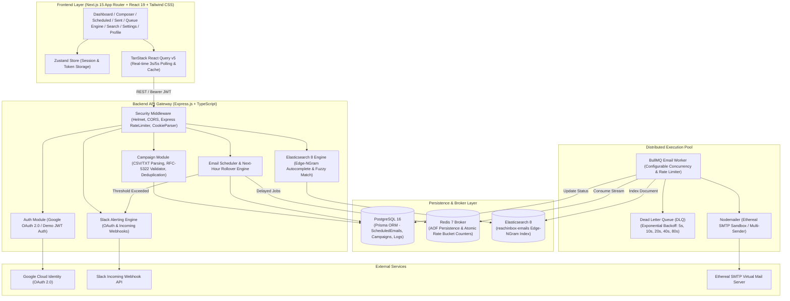

## 1. Architecture Overview

### System Architecture Diagram



---

### How Scheduling Works

Traditional cron jobs (`node-cron`, `setInterval`) store timer callbacks in Node.js heap memory; if the process crashes or scales across containers, all scheduled timers disappear.

ReachInbox implements **BullMQ Delayed Jobs** backed by Redis Sorted Sets (`zset`):
1. **Timestamp Calculation**: When a campaign is submitted, each recipient is assigned an exact delivery timestamp:
   $$\text{DeliveryTime}_i = \text{BaseScheduleTime} + (i \times \text{DelaySeconds})$$
2. **Delay Offset**: The scheduler calculates the exact millisecond offset:
   $$\text{delayMs} = \max(0, \text{DeliveryTime}_i - \text{Date.now()})$$
3. **Queue Enqueueing**: The job is enqueued with a unique deterministic ID (`email-${scheduledEmailId}`) and delayed execution:
   ```typescript
   await emailQueue.add('send-email', jobPayload, {
     delay: delayMs,
     jobId: `email-${emailRecord.id}`,
   });
   ```
4. **State Lifecycle**:
   - `PENDING`: Stored in PostgreSQL awaiting queue assignment.
   - `DELAYED`: Sleeping inside Redis Sorted Sets until its target timestamp arrives.
   - `PROCESSING`: Picked up by the BullMQ worker for SMTP transmission.
   - `SENT`: Delivered successfully with `200 OK` from SMTP, message ID recorded, and synced to Elasticsearch.
   - `FAILED`: Placed in Dead-Letter Queue if all 5 exponential retry attempts fail.

---

### How Persistence on Restart is Handled

ReachInbox ensures 100% crash resilience through dual-layer persistence:

1. **Redis AOF (Append-Only File) Persistence**:
   - Redis is configured with `appendonly yes` and `appendfsync everysec`.
   - Every delayed job, payload, and retry state is persisted to disk. If Docker restarts or the host reboots, Redis reconstructs the exact queue state with millisecond accuracy.
2. **PostgreSQL Relational Ground Truth**:
   - All email dispatches are tracked in the `ScheduledEmail` table with their `bullJobId`, status, scheduled time, and campaign ID.
   - Audit transitions are permanently recorded in the `QueueLog` table.
3. **Automatic Startup State Sync**:
   - On backend boot, `elasticsearchService.syncFromDatabase()` cross-checks PostgreSQL with Elasticsearch and Redis, ensuring zero orphan records and repairing any discrepancies.

---

### How Rate Limiting & Concurrency are Implemented

1. **Atomic Redis Hour Buckets**:
   - Every dispatch hour is bucketed as `YYYY-MM-DD-HH` in UTC.
   - Redis tracks two atomic counters using `.multi().get().exec()`:
     - **Global hourly limit**: `rate:global:<YYYY-MM-DD-HH>`
     - **Per-sender hourly limit**: `rate:sender:<senderEmail>:<YYYY-MM-DD-HH>`
2. **Dynamic Next-Hour Rollover Algorithm**:
   - When a sender reaches `MAX_EMAILS_PER_SENDER` (e.g. 50/hour) or the global system hits `MAX_EMAILS_PER_HOUR` (e.g. 200/hour):
     - **Zero emails are dropped or rejected.**
     - The scheduler dynamically rolls candidate delivery to the top of the next hour window (`00:00:00` UTC).
     - Recipient ordering is preserved.
     - An automatic Slack alert is dispatched alerting operations of the rollover.
3. **Worker Pool Concurrency**:
   - The BullMQ worker is instantiated with a dedicated concurrency pool:
     ```typescript
     this.worker = new Worker(EMAIL_QUEUE_NAME, processJob, {
       connection: redisConnection,
       concurrency: config.scheduler.workerConcurrency, // default 5 parallel async threads
       limiter: {
         max: config.scheduler.maxEmailsPerHour,
         duration: 3600 * 1000,
       },
     });
     ```
   - Multiple emails are processed simultaneously without exceeding the SMTP provider's connection ceiling.

---

## 2. List of Features Implemented

### Backend Features

| Category | Implemented Capabilities |
|---|---|
| **Scheduler** | • Dynamic millisecond delay calculation via BullMQ delayed streams<br>• Job cancellation (`cancelJob`) with immediate Redis and PostgreSQL deletion<br>• Zero-drop next-hour rollover engine<br>• Custom inter-email pacing (`EMAIL_DELAY_SECONDS`) |
| **Persistence** | • Redis AOF disk-backed delayed job broker<br>• PostgreSQL schema managed via Prisma ORM (7 relational models)<br>• Permanent `QueueLog` audit trail for every status transition<br>• Automatic database-to-Elasticsearch bulk synchronization on startup |
| **Rate Limiting** | • Global hourly cap enforcement (`MAX_EMAILS_PER_HOUR`)<br>• Per-sender hourly cap enforcement (`MAX_EMAILS_PER_SENDER`)<br>• Atomic Redis counter increments with 48h TTL<br>• Real-time Slack rate-limit rollover webhook alerts |
| **Concurrency & Workers** | • Configurable worker pool concurrency (`WORKER_CONCURRENCY`, 1x–50x)<br>• Exponential backoff retries (5 attempts: 5s, 10s, 20s, 40s, 80s)<br>• Dead-Letter Queue (`email-dlq`) for unrecoverable failures<br>• Pause & Resume queue controls exposed via REST API |
| **Search Engine** | • Elasticsearch 8 cluster integration (`reachinbox-emails` index)<br>• Custom `edge_ngram` analyzer (min 2, max 20) for sub-10ms autocomplete<br>• Multi-field fuzzy matching (`fuzziness: 'AUTO'`) across recipients & subjects<br>• Automatic fallback to PostgreSQL `ILIKE` if Elasticsearch is offline |
| **Authentication** | • Google OAuth 2.0 via Passport.js with real Google Consent Screen<br>• Instant Developer Demo Sign-In generating signed JWT tokens<br>• Secure httpOnly cookie session management & CSRF protection |

---

### Frontend Features

| Page / Component | Implemented Capabilities |
|---|---|
| **Login (`/login`)** | • Google OAuth 2.0 redirection to `accounts.google.com`<br>• One-click Instant Engineer Demo Sign-In<br>• Client-side session hydration via Zustand store |
| **Dashboard (`/dashboard`)** | • 4 real-time KPI metric cards (Scheduled, Dispatched, Concurrency, DLQ)<br>• Background polling every 5 seconds (`GET /api/queue/stats`)<br>• Quick action shortcuts (Compose, Queue Status, View All) |
| **Compose (`/compose`)** | • Internal campaign name & subject line inputs<br>• Rich HTML body editor with live rendered **Preview** tab<br>• Recipient ingestion via drag-and-drop CSV/TXT file upload or direct text paste<br>• Real-time client-side RFC-5322 regex validation & duplicate detection metrics<br>• Start-time datepicker and customizable inter-email delay setting |
| **Scheduled Queue (`/scheduled`)** | • Interactive delayed queue table with countdown execution times<br>• Live recipient and subject search bar with instant debounce<br>• Status filter pills (`All Active`, `Pending`, `Delayed`, `Queued`, `Failed`)<br>• **Job Cancellation**: One-click cancel button removing jobs from Redis & DB immediately |
| **Sent Emails (`/sent`)** | • Delivered emails table with ISO timestamps and unique SMTP Message IDs<br>• **1-Click "View Preview"**: Opens rendered email inside the Ethereal Mail Sandbox |
| **Queue Engine (`/queue`)** | • 8 live broker KPI cards (Pending, Delayed, Active, Completed, DLQ, Retrying, Pool, Concurrency)<br>• Interactive **Pause Queue** / **Resume Queue** toggle controls<br>• Real-Time Queue Event Audit Trail table with live status badges<br>• Direct button opening the embedded **Bull-Board visual dashboard** (`:5000/admin/queues`) |
| **Global Search (`/search`)** | • Full-text fuzzy search powered by Elasticsearch 8<br>• **Edge-NGram Autocomplete Popover**: 100% opaque dropdown with arrow key navigation & Enter key submission<br>• Typo-tolerant matching (`fuzziness: AUTO`)<br>• Status filter pills and pagination controls (`Page 1 of N`) |
| **Settings (`/settings`)** | • Dynamic rate limit adjustments (`MAX_EMAILS_PER_HOUR`, `MAX_EMAILS_PER_SENDER`, `EMAIL_DELAY_SECONDS`, `WORKER_CONCURRENCY`)<br>• Default outbound sender email and sender name configuration<br>• Slack integration: OAuth connection, Instant Demo Slack Sandbox, and manual Webhook URL input with live **"Send Test Alert"** testing |
| **Profile (`/profile`)** | • Authenticated Google identity details, avatar, and role badges (`ADMIN` / `USER`)<br>• Cryptographic session verification info<br>• Secure **Sign Out** clearing cookies, tokens, and redirecting with protected route enforcement |

---

## 3. How to Run the Application

### Method 1: One-Command Launch (Docker Compose) — *Recommended*

The entire multi-container stack (Next.js frontend, Express backend, PostgreSQL, Redis, Elasticsearch) is orchestrated via Docker Compose.

```bash
# 1. Clone the repository
git clone https://github.com/your-username/reachinbox.git
cd reachinbox

# 2. Start all 5 services with live build
docker compose up --build
```

#### Access Points
| Service | URL |
|---|---|
| **Frontend Web App** | [http://localhost:3000](http://localhost:3000) |
| **Backend REST API** | [http://localhost:5000](http://localhost:5000) |
| **Swagger API Documentation** | [http://localhost:5000/api/docs](http://localhost:5000/api/docs) |
| **Bull-Board Queue Dashboard** | [http://localhost:5000/admin/queues](http://localhost:5000/admin/queues) |
| **Health Check Endpoint** | [http://localhost:5000/api/health](http://localhost:5000/api/health) |

---

### Method 2: Manual Local Setup

If running locally without Docker:

#### Prerequisites
- Node.js >= 20.x
- PostgreSQL 16 running on port `5432`
- Redis 7 running on port `6379`
- Elasticsearch 8 running on port `9200` (optional; falls back to PostgreSQL if unavailable)

---

#### 1. Running the Backend

```bash
cd backend

# Install dependencies
npm install

# Configure environment variables
cp .env.example .env

# Generate Prisma Client & push schema to PostgreSQL
npx prisma generate
npx prisma db push

# (Optional) Run test suite to verify scheduler & parser
npm test

# Start the Express API & BullMQ Background Worker
npm run dev
```

*The backend boots on port `5000`. The BullMQ worker starts automatically in the background alongside Express.*

---

#### 2. Running the Frontend

```bash
cd frontend

# Install dependencies
npm install

# Configure environment variables
cp .env.example .env.local

# Start Next.js 15 development server
npm run dev
```

*Open [http://localhost:3000](http://localhost:3000) in your browser.*

---

## 4. Ethereal Email Setup & Environment Variables

### Ethereal Email Setup

ReachInbox uses **Ethereal Email** (`ethereal.email`) by default for safe sandbox testing:
- **Zero Manual Setup Required**: When `USE_ETHEREAL_EMAIL=true`, Nodemailer automatically provisions a virtual disposable SMTP test account upon server boot using `nodemailer.createTestAccount()`.
- **Zero Spam Risk**: Outbound emails are captured by the virtual SMTP server and never sent to real recipient inboxes.
- **One-Click Previews**: When an email is dispatched, Nodemailer returns a preview URL via `nodemailer.getTestMessageUrl(info)`. This URL is saved in PostgreSQL (`etherealUrl`) and surfaced as a clickable **"View Preview"** button on the `/sent` page.
- **Custom Production SMTP**: To use a real SMTP service (e.g. AWS SES, SendGrid, Gmail SMTP), simply set `USE_ETHEREAL_EMAIL=false` and provide `SMTP_HOST`, `SMTP_PORT`, `SMTP_USER`, and `SMTP_PASS` in `backend/.env`.

---


## 5. Testing & Verification

The backend includes a comprehensive **Jest test suite** testing the CSV/TXT recipient parser, RFC-5322 regex validation, duplicate detection, hourly rate limit rollovers, and API health endpoints.

```bash
# Run all backend unit & integration tests
npm --prefix backend test
```

### Verified Test Output
```text
PASS tests/api.test.ts
  API Integration Tests
    ✓ GET / should return 200 with service information
    ✓ GET /api/health should return UP status
    ✓ GET /api/non-existent-route should return 404

PASS tests/scheduler.test.ts
  EmailScheduler Rate Limiting & Rollover Logic
    ✓ should format UTC hour keys consistently
    ✓ should calculate inter-email delay correctly
    ✓ should roll over timestamp into next full hour when limit reached

PASS tests/email-parser.test.ts
  EmailParser Unit Tests
    ✓ should parse valid emails from CSV format with headers
    ✓ should detect and remove duplicate emails
    ✓ should flag malformed email addresses
    ✓ should handle semicolon and tab delimited content

Test Suites: 3 passed, 3 total
Tests:       10 passed, 10 total
Snapshots:   0 total
```

---
